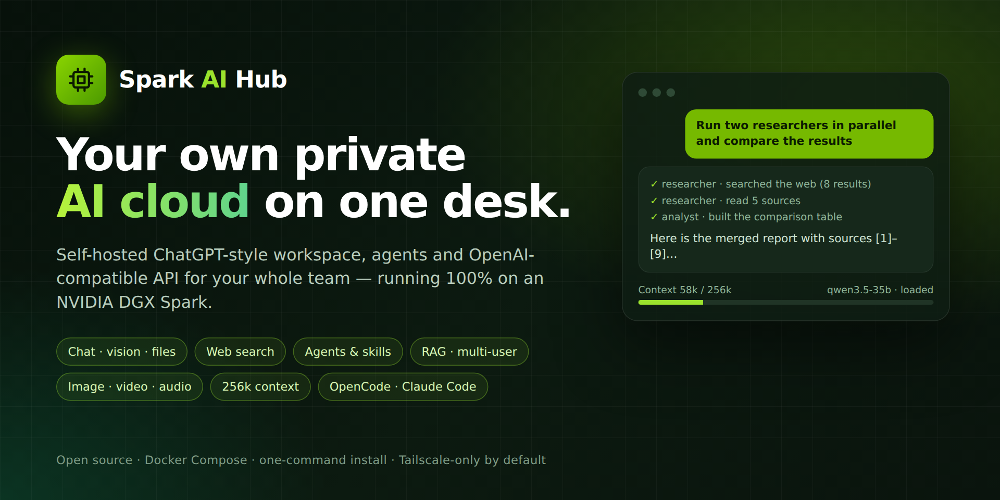
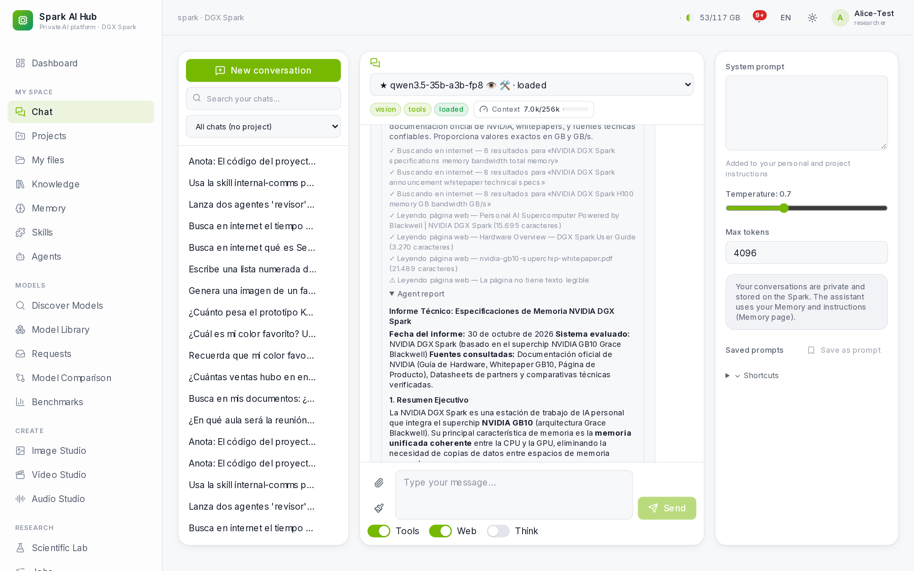

<p align="center">
  
</p>

<h1 align="center">Spark AI Hub</h1>

<p align="center">
  <b>Convierte un NVIDIA DGX Spark en la nube de IA privada de todo tu equipo.</b><br>
  Chat con visión y archivos · búsqueda en internet · agentes y skills · RAG sobre tus documentos · estudios de imagen,
  vídeo y audio · API compatible con OpenAI y Anthropic para OpenCode, Claude Code, Cline… Todo en tu mesa, nada sale de ella.
</p>

<p align="center"><a href="README.md">English</a> · <a href="CHANGELOG.md">Changelog</a></p>

---

## Qué es

Un DGX Spark tiene 128 GB de memoria unificada: cabe un modelo MoE de 125B en FP4 con 256k tokens de contexto, los embeddings y
los embeddings a la vez. Lo que le falta es la *plataforma*: cuentas de usuario, un chat agradable, una biblioteca de
modelos compartida, una API para agentes de programación y algo que decida qué se queda en memoria. **Spark AI Hub es
esa plataforma.** Se instala con un comando, invitas a tus compañeros y cada uno tiene su espacio privado tipo ChatGPT y
su clave API, sin enviar ni un prompt a servicios de IA externos.

<p align="center"></p>

## Funciones

- **Chat**: modelo general siempre cargado (recomendado: Qwen3.8-Flash-Next FP4, visión y herramientas, **256k de
  contexto**, ~45 tok/s; se elige en un clic en la tarjeta **Modelo principal**); edita, copia, regenera o retoma
  cualquier mensaje; adjunta
  imágenes, PDF (también escaneados), Word, PowerPoint, Excel/CSV y código; genera y edita imágenes; las respuestas
  siguen aunque cierres la pestaña.
- **Búsqueda en internet** con un SearXNG privado dentro del propio hub; lee páginas y PDF y cita las fuentes. Nunca abre
  direcciones internas.
- **Agentes**: 20 incluidos (investigador, programador, tester, depurador, estadístico, redactor científico,
  maquetador LaTeX, traductor, verificador…) o los tuyos, varios **en paralelo** con progreso en directo e informe.
  En el Workspace también escriben y ejecutan código, cada uno en sus archivos.
- **Skills**: 17 incluidas (informes LaTeX y Beamer, Excel con gráficos, Word, PowerPoint, gráficos de publicación,
  estadística, artículos IMRaD, BibTeX, propuestas de proyecto, TFG/TFM, revisión por pares, rúbricas…); más desde
  GitHub o un enlace, escritas por ti o instaladas por el propio modelo cuando las necesita.
- **Ventana de contexto** ajustable con indicador en vivo y **compactación automática** (resume, no olvida).
- **Workspace (harness remoto)**: carpetas propias en el Spark con archivos, editor, vistas previas (Excel, PDF, imágenes, HTML), terminal y un asistente que escribe, ejecuta y corrige código allí. Sube un CSV, pide «un Excel con el resumen por mes y un gráfico» y descárgalo.
- **Cerebro para robots**: conecta un programa de control de robots al Spark. De texto a movimiento del Unitree G1 con NVIDIA Kimodo y comprobación física con MuJoCo, con dirección copiable y biblioteca de modelos ([documentación, en inglés](docs/robot-server.md)).
- **Ejecuta código** en un entorno aislado sin internet: cálculos, gráficos y archivos Excel, Word, PowerPoint o PDF.
- **Lienzo** junto al chat para informes, cartas o código: edítalo, pide cambios y expórtalo a **Word, PDF o Markdown**.
- **Investigación a fondo**: varios agentes en paralelo y un informe largo con fuentes numeradas.
- **Voz**: dicta con 🎤 y escucha las respuestas (Whisper y voces locales).
- **Tareas programadas**: «cada lunes a las 9, resúmeme…»; te avisa y puede enviarte el resultado por correo.
- **Conectores** que sincronizan tu base de conocimiento con **Nextcloud/WebDAV, GitHub, Zotero y carpetas de red**.
- **Entrar con Google o Microsoft** (u otro proveedor OpenID Connect) y **panel de uso** por modelo, proyecto y persona.
- **Nube personal**: Mis archivos, base de conocimiento (búsqueda híbrida pgvector), proyectos compartidos, memoria.
- **Para programar**: API `/v1` compatible con OpenAI, `/v1/messages` compatible con Anthropic (Claude Code), servidor
  **MCP**, y la página **Conectar herramientas** genera la configuración de OpenCode, Claude Code, Cline, Continue,
  Cursor, Aider, Python… con tu clave y la ventana real del modelo.
- **Modelos sin complicaciones**: explorador de Hugging Face con veredicto de compatibilidad y memoria, instalación con
  verificación, parsers de herramientas automáticos, planificador de memoria unificada (descarga modelos inactivos a los
  5 min), **ventana de contexto por modelo en un clic**, comparación y benchmarks.
- **Estudios** de imagen, vídeo y audio; **laboratorio científico**.
- **Gestión**: registro con aprobación, invitaciones por correo, roles, cuotas, monitorización, alertas, copias de
  seguridad verificadas, **guías paso a paso en cada página**, app **Android**.
- **Seguro por defecto**: solo se publica `127.0.0.1:8080`; acceso remoto por **Tailscale Serve** (solo tu tailnet).

## Requisitos

| | Mínimo | Recomendado / probado |
|---|---|---|
| **Hardware** | Equipo con GPU NVIDIA y 64 GB de RAM | **NVIDIA DGX Spark** (GB10, 128 GB, aarch64) |
| **Sistema** | Ubuntu 22.04+ | DGX OS 7 (Ubuntu 24.04) |
| **Software** | Docker 27+ con Compose v2, NVIDIA Container Toolkit, `python3`, `curl` | lo que trae DGX OS |
| **Disco** | 150 GB libres | 1 TB o más (el modelo general ocupa ~37 GB) |
| **Red** | Internet para instalar y descargar modelos | [Tailscale](https://tailscale.com) con certificados HTTPS |

## Instalación rápida

```bash
git clone https://github.com/polila6/spark-ai-hub.git
cd spark-ai-hub
./install.sh                 # añade --with-studios para los motores de imagen, vídeo y audio
```

El instalador comprueba los requisitos, crea `.env`, prepara `/srv/spark-ai-hub` (pide `sudo` una vez), genera los
secretos, construye y arranca todo, y te muestra la dirección y el acceso de administrador (20–40 min la primera vez).

Después, en la web:

1. Entra como `admin` con la contraseña de `/srv/spark-ai-hub/config/secrets/admin_password` y cámbiala.
2. **Modelos** → tarjeta **Modelo principal** → **Cambiar** → elige `nvidia/Qwen3.8-Flash-Next-FP4-Local` (96 GiB; el
   primer arranque afina los kernels unos 45 min) o el más ligero `Qwen/Qwen3.5-35B-A3B-FP8` → **Descargar y hacer
   principal**. Cambia solo al terminar la descarga y será el modelo de todos por defecto.
3. **Usuarios** → invita por correo o permite solicitudes de registro (Ajustes → Acceso y correo).
4. **Conectar herramientas** → crea una clave API y copia la configuración de tu editor o agente.

Cada página tiene su guía **«¿Cómo se usa?»** con estos pasos. Más detalles: [docs/DEPLOYMENT.md](docs/DEPLOYMENT.md) ·
[guía del administrador](docs/ADMIN_GUIDE.md).

## Licencia

[MIT](LICENSE). Los modelos que descargues mantienen su propia licencia (se muestra antes de instalarlos).
Spark AI Hub es un proyecto independiente, sin relación con NVIDIA.
