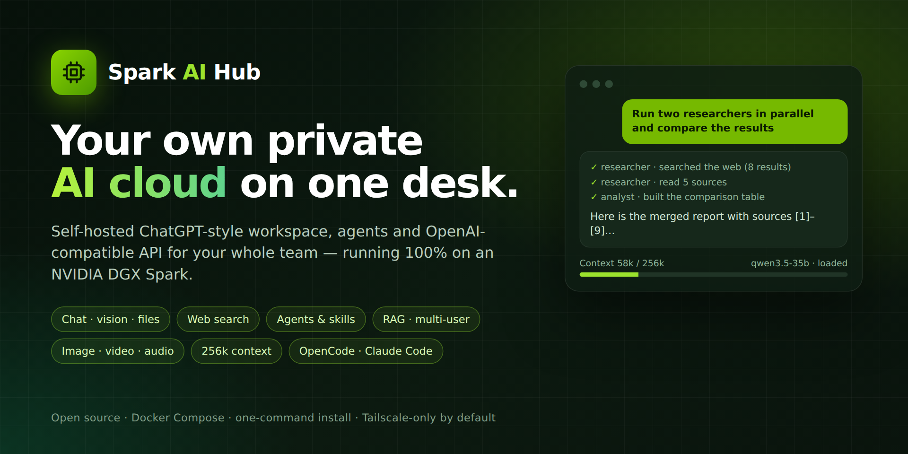
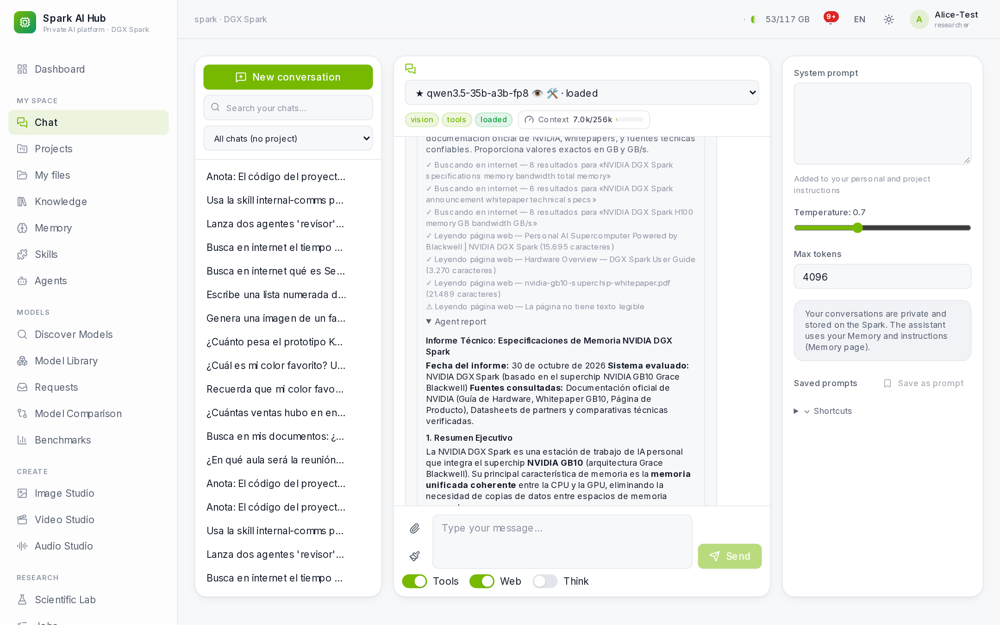
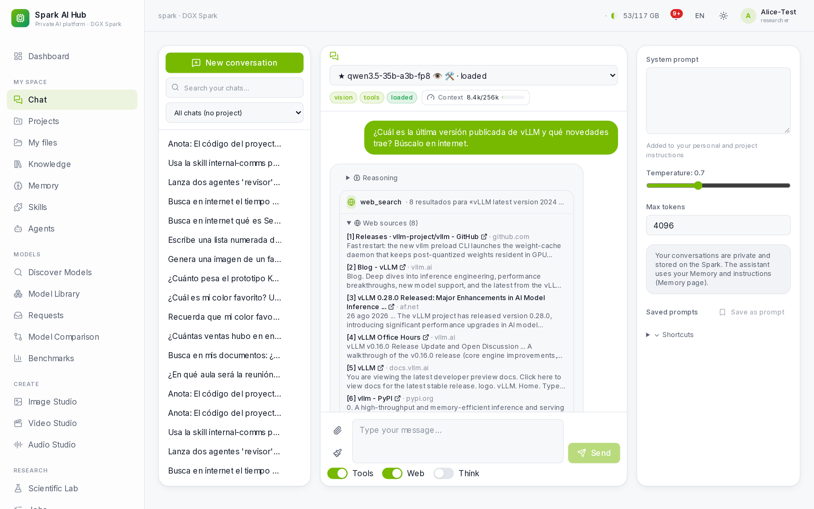
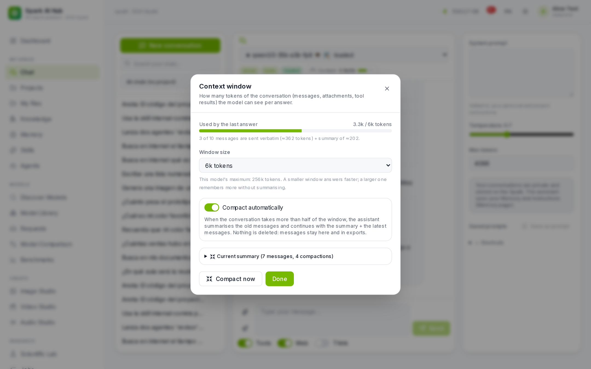
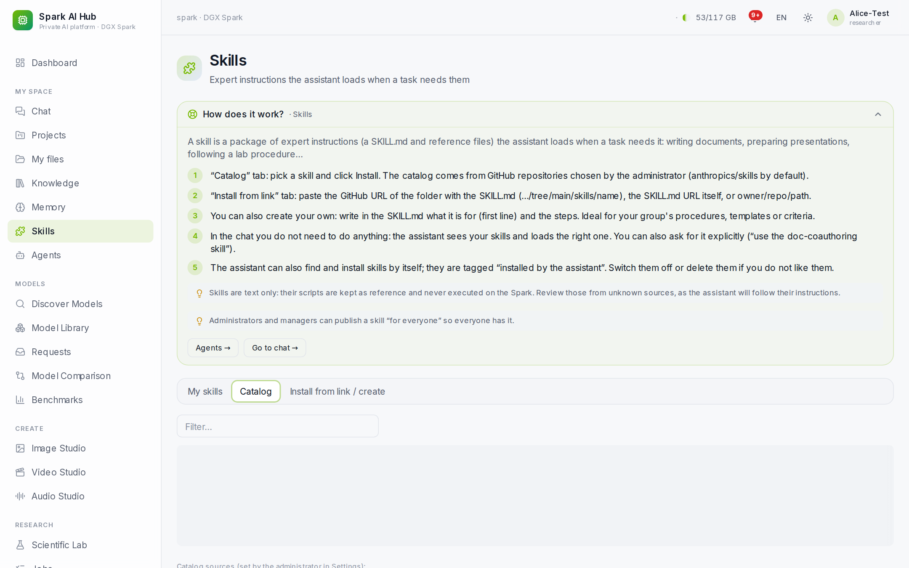
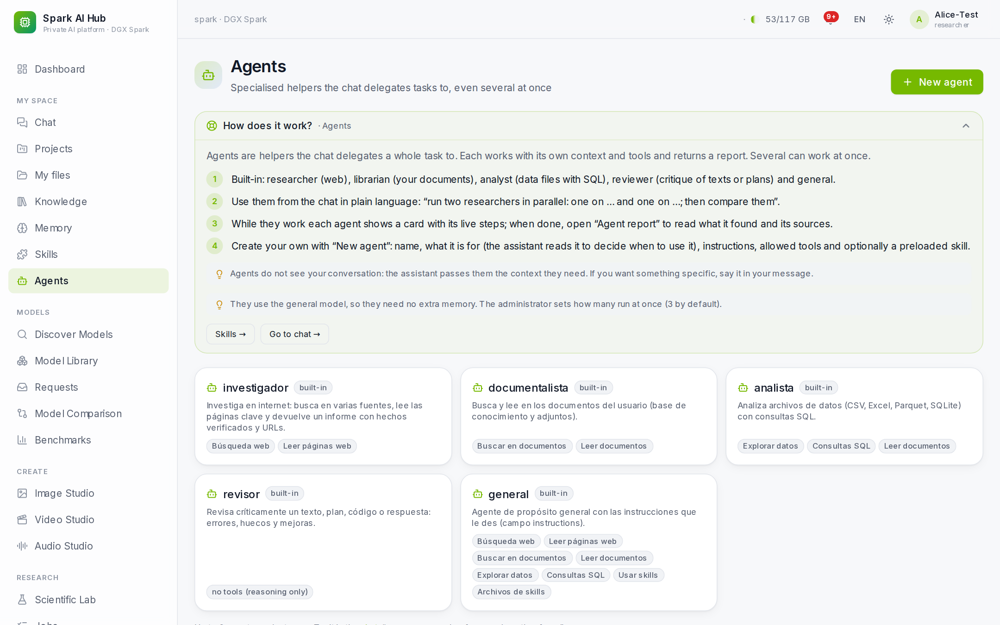
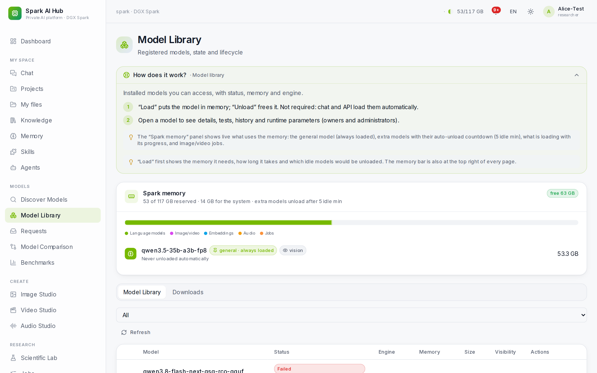
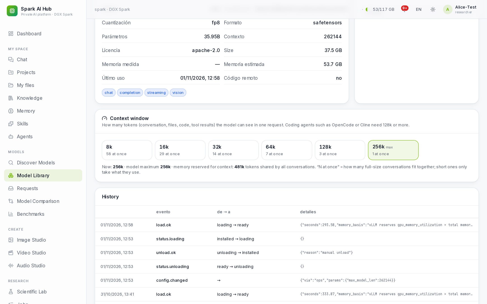
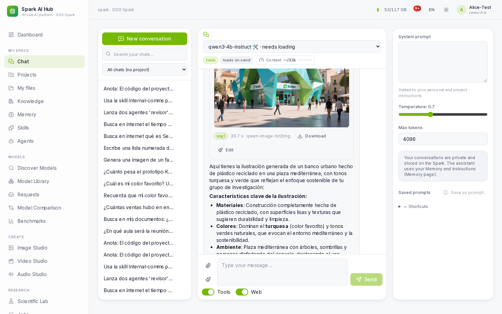
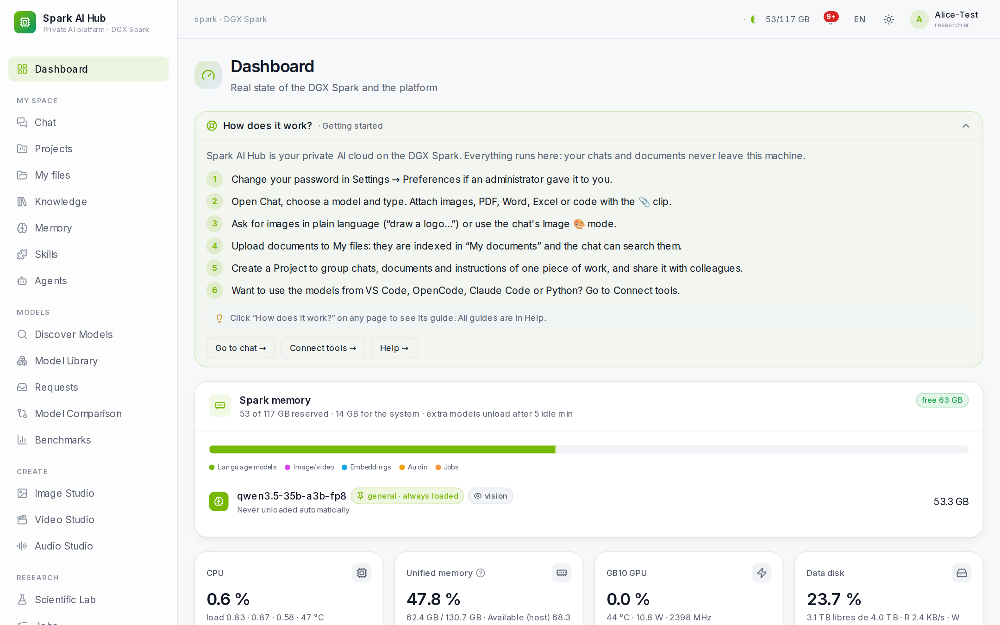

<p align="center">
  
</p>

<h1 align="center">Spark AI Hub</h1>

<p align="center">
  <b>Turn an NVIDIA DGX Spark into a private AI cloud for your whole team.</b><br>
  Chat with vision and files · web search · agents & skills · RAG over your documents · image, video & audio studios ·
  OpenAI- and Anthropic-compatible API for OpenCode, Claude Code, Cline and friends — all on one desk, nothing leaves it.
</p>

<p align="center">
  <a href="#-quick-start">Quick start</a> ·
  <a href="#-features">Features</a> ·
  <a href="#-requirements">Requirements</a> ·
  <a href="#-connect-your-tools">Connect tools</a> ·
  <a href="CHANGELOG.md">Changelog</a> ·
  <a href="README.es.md">Español</a>
</p>

<p align="center">
  
  
  
  
</p>

---

## Why

A DGX Spark has 128 GB of unified memory: enough for a 35B model with a 256k-token context, an image model and
embeddings at the same time. What it lacks is the *platform*: accounts, a chat people actually like, a shared model
library, an API for coding agents, and something that decides what stays in memory. **Spark AI Hub is that platform.**
Install it with one command, invite your colleagues, and everybody gets a private ChatGPT-style workspace and an API key —
without sending a single prompt to an external AI service.

<p align="center">
  
</p>

## ✨ Features

### Chat that does real work
- **One general model always loaded** (default: Qwen3.5-35B-A3B FP8, vision + tools, **256k context**), others load on demand.
- **Attach anything**: images, PDFs (scanned ones too), Word, PowerPoint, Excel/CSV, code. Ask questions over data with sandboxed SQL.
- **Web search** through a private [SearXNG](https://github.com/searxng/searxng) inside the hub; pages and PDFs are read and cited. SSRF-safe: internal addresses are never fetched.
- **Agents**: the assistant delegates to sub-agents (researcher, writer, analyst, reviewer, or your own) — several **in parallel**, with live progress and a report each.
- **Skills**: install [Agent Skills](https://github.com/anthropics/skills) from GitHub or a link, write your own, or let the model find and install the one it needs.
- **Context window you control**: live meter, adjustable size, **automatic compaction** that summarises old messages instead of forgetting them.
- **Images in the chat**: "draw a logo…" or edit an attached photo (Qwen-Image / Qwen-Image-Edit).
- Answers keep running in the background if you close the tab; notifications when they finish.

### Your private cloud
- **My files** with text extraction, **knowledge base** (pgvector hybrid search), **projects** with shared instructions, documents and chats, and a personal **memory**.
- Everything is private per user; sharing is explicit (users or projects). Data export and account deletion built in.

### Built for coding agents
- **OpenAI-compatible** `/v1` (chat, streaming, tools, embeddings) and **Anthropic Messages** `/v1/messages` (Claude Code).
- **MCP server** (`/mcp`) exposing your files, knowledge base, chats, memory and image generation to any MCP client.
- **"Connect tools" page** generates ready-to-paste configuration for OpenCode, Claude Code, Cline, Continue, Cursor, Aider, Claude Desktop, Open WebUI, Python and LangChain — with your key, your OS and the model's real context window.

### Models without the pain
- **Discover** Hugging Face models with a compatibility verdict and memory estimate for *your* machine; one-click install with checksum verification. Tool-calling parsers are configured automatically for known families.
- **Unified-memory scheduler**: knows what fits, unloads idle models after 5 minutes, shows a load plan (memory, ETA, what would be unloaded) before loading.
- **Context window per model** in one click, showing how many conversations of each size fit at once.
- Model comparison, reproducible **benchmarks**, smoke tests, model requests with approval.

### Create and research
- **Image, Video and Audio studios** (ComfyUI and an ML worker, started on demand).
- **Scientific lab**: datasets, trusted adapters, reproducible experiments.

### Run it like a service
- Accounts with sign-up approval, e-mail invitations, roles (admin, manager, researcher, viewer), quotas and rate limits.
- Monitoring (CPU, GPU, memory, temperature, disk), alerts, audit log, verified **backups** with restore test.
- **Guided instructions on every page** (Spanish and English UI), help centre, printable user/admin guides.
- **Android app** (WebView shell with share-to-chat and camera upload) built on the Spark itself.
- Secure by default: only `127.0.0.1:8080` is published; remote access through **Tailscale Serve** (tailnet only, never Funnel). Argon2id, CSRF, per-user API keys, Docker socket held by a single allow-listed engine manager.

<table>
  <tr>
    <td><br><sub><b>Web search</b> with cited sources</sub></td>
    <td><br><sub><b>Context window</b> and automatic compaction</sub></td>
  </tr>
  <tr>
    <td><br><sub><b>Skills</b> catalog from GitHub</sub></td>
    <td><br><sub>Built-in and custom <b>agents</b></sub></td>
  </tr>
  <tr>
    <td><br><sub><b>Unified-memory</b> panel and model library</sub></td>
    <td><br><sub><b>256k context</b> in one click</sub></td>
  </tr>
  <tr>
    <td><br><sub><b>Image generation</b> from the chat</sub></td>
    <td><br><sub><b>Dashboard</b> with first steps</sub></td>
  </tr>
</table>

## 📋 Requirements

| | Minimum | Recommended / tested |
|---|---|---|
| **Hardware** | NVIDIA GPU host, 64 GB RAM | **NVIDIA DGX Spark** (GB10, 128 GB unified memory, aarch64) |
| **OS** | Ubuntu 22.04+ | DGX OS 7 (Ubuntu 24.04) |
| **Software** | Docker 27+ with Compose v2, NVIDIA Container Toolkit, `python3`, `curl` | as shipped with DGX OS |
| **Disk** | 150 GB free | 1 TB+ for several models (the general model is ~37 GB) |
| **Network** | Internet for the first install and model downloads | [Tailscale](https://tailscale.com) with HTTPS certificates, for access from other devices |
| **Accounts** | — | A Hugging Face token for gated models (set in Settings) |

> Other NVIDIA machines (x86_64 with a recent GPU) should work but are not tested. Images are pinned to NGC releases built for both architectures.

## 🚀 Quick start

```bash
git clone https://github.com/polila6/spark-ai-hub.git
cd spark-ai-hub
./install.sh                 # add --with-studios to also build the image/video/audio engines
```

The installer checks the requirements, writes `.env`, prepares `/srv/spark-ai-hub` (asks for `sudo` once), generates
secrets, pulls the vLLM image, builds and starts everything, and prints the address and the admin login. First run:
20–40 minutes, mostly downloads. Re-running it is safe.

Then, in the web app:

1. **Log in** as `admin` with the password from `/srv/spark-ai-hub/config/secrets/admin_password` and change it.
2. **Discover models** → search `Qwen3.5-35B-A3B-FP8` → **Install**. When it is ready, open it in the **Library** and
   click **Pin resident**: it becomes the general model everyone uses by default.
3. **Users** → invite colleagues by e-mail, or allow sign-up requests (Settings → Access and mail).
4. **Connect tools** → create an API key and copy the configuration for your editor or agent.

Every page has a **"How does it work?"** guide with these steps.

<details>
<summary><b>Manual installation</b></summary>

```bash
cp .env.example .env && nano .env              # address, data root, docker group id, organisation name
sudo bash scripts/host-setup.sh                # data folders + Tailscale Serve (tailnet only)
bash scripts/init-secrets.sh                   # secrets and the initial admin password
docker pull nvcr.io/nvidia/vllm:26.09-py3
scripts/sah.sh build                           # + scripts/sah.sh build-engines for the studios
scripts/sah.sh up
```

Details, upgrades and rollback: [docs/DEPLOYMENT.md](docs/DEPLOYMENT.md).
</details>

## 🔌 Connect your tools

Any OpenAI-compatible client works with `https://<your-spark>/v1` and a personal key:

```python
from openai import OpenAI
client = OpenAI(base_url="https://your-spark.your-tailnet.ts.net/v1", api_key="sah-...")
print(client.chat.completions.create(model="qwen3.5-35b-a3b-fp8",
      messages=[{"role": "user", "content": "Hello from my DGX Spark"}]).choices[0].message.content)
```

**OpenCode** (`~/.config/opencode/opencode.json`, generated for you in *Connect tools*):

```json
{
  "$schema": "https://opencode.ai/config.json",
  "provider": {
    "spark": {
      "npm": "@ai-sdk/openai-compatible",
      "name": "Spark AI Hub",
      "options": { "baseURL": "https://your-spark.your-tailnet.ts.net/v1", "apiKey": "{env:SPARK_API_KEY}" },
      "models": { "qwen3.5-35b-a3b-fp8": { "name": "Qwen3.5 35B (Spark)", "limit": { "context": 262144, "output": 16384 } } }
    }
  },
  "model": "spark/qwen3.5-35b-a3b-fp8"
}
```

**Claude Code**: `ANTHROPIC_BASE_URL=https://your-spark.your-tailnet.ts.net` and `ANTHROPIC_AUTH_TOKEN=sah-...` — the
hub answers `/v1/messages` with the general model. More in [docs/API.md](docs/API.md).

## 🏗️ Architecture

```
Your devices ── Tailscale ── Serve (HTTPS, tailnet only) ── 127.0.0.1:8080 Caddy
                                                              ├─ /         → frontend (Next.js 15)
                                                              └─ /api, /v1 → backend (FastAPI)
backend · worker · monitor ─┬─ PostgreSQL 16 + pgvector, Redis      (internal network)
                            ├─ SearXNG                               (egress only, for web search)
                            ├─ engine-manager ─ docker.sock          (allow-listed operations only)
                            └─ Ollama · vLLM (one container per model) · ComfyUI · ML worker
```

Data, models and secrets live in `/srv/spark-ai-hub`, never in the repository.
More: [ARCHITECTURE](docs/ARCHITECTURE.md) · [SECURITY](docs/SECURITY.md) · [STORAGE](docs/STORAGE.md).

## 🛠️ Operations

```bash
scripts/sah.sh status          # services, engines, health
scripts/sah.sh up | down       # start / stop everything (data is kept)
scripts/sah.sh logs backend    # follow logs
scripts/sah.sh backup          # verified backup (database, config, registry, user data)
scripts/sah.sh update          # git pull + rebuild + restart (migrations run automatically)
scripts/sah.sh reset-link admin   # emergency password-reset link (needs shell access)
```

## 📚 Documentation

| Topic | |
|---|---|
| Install, upgrade, rollback | [DEPLOYMENT](docs/DEPLOYMENT.md) |
| Administrators (ES) · users | [ADMIN_GUIDE](docs/ADMIN_GUIDE.md) · [USER_GUIDE](docs/USER_GUIDE.md) |
| REST, OpenAI, Anthropic and MCP APIs | [API](docs/API.md) |
| Architecture · security · storage | [ARCHITECTURE](docs/ARCHITECTURE.md) · [SECURITY](docs/SECURITY.md) · [STORAGE](docs/STORAGE.md) |
| Engines and scientific adapters | [MODEL_ADAPTERS](docs/MODEL_ADAPTERS.md) · [COMPATIBILITY_MATRIX](docs/COMPATIBILITY_MATRIX.md) |
| Benchmarks · backups · troubleshooting | [BENCHMARKS](docs/BENCHMARKS.md) · [BACKUP_RECOVERY](docs/BACKUP_RECOVERY.md) · [TROUBLESHOOTING](docs/TROUBLESHOOTING.md) |

## 🗺️ Roadmap

- Sandboxed code execution for skills and data analysis (no network, CPU/memory/time limits).
- Voice mode in the chat (local speech-to-text and text-to-speech).
- Scheduled tasks ("every Monday, summarise…") and shared team agents.
- Single sign-on (OIDC/SAML) for organisations.

Ideas and pull requests are welcome — open an issue first for larger changes.

## 🤝 Contributing

```bash
scripts/sah.sh unit                          # backend unit tests (in the backend image)
SAH_BASE_URL=https://... scripts/sah.sh test # acceptance tests against a running hub (creates test accounts)
```

Please never commit `.env`, secrets, model weights or user data (see `.gitignore`).

## License

[MIT](LICENSE). Models you download keep their own licences, shown before installation.
Spark AI Hub is an independent project and is not affiliated with or endorsed by NVIDIA.
